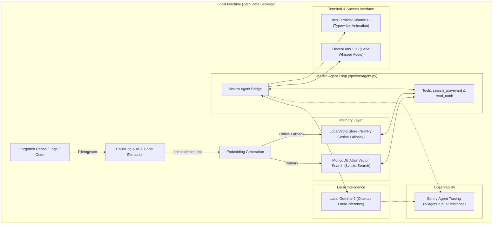

# Spectre-CLI 🕯️👻
> **Autonomous Digital Séance for Forgotten Files, Deprecated Projects & Historical Logs**  
> *Built for Hacktoberfest 2026: Week 4 "Ghost in the Machine" Challenge*

```text
   .---.          .---.
  /     \  .-.   /     \     S P E C T R E - C L I
 | () () |/   \ | () () |    Autonomous Digital Séance for Forgotten Files
  \  _  / \ _ /  \  _  /     Hacktoberfest 2026: Ghost in the Machine
   `---'   `-'    `---'
```

---

## 🔮 What is Spectre-CLI?

Every developer has a "code graveyard": abandoned git branches, half-finished prototypes from 2021, cryptic `.log` archives, and forgotten scratchpads with unresolved `TODO: fix this tomorrow` comments.

**Spectre-CLI** acts as a **privacy-first digital medium**. It conducts a terminal séance to exhume, index, and commune with these dead machines and historical logs. Instead of sending private source files to third-party cloud LLMs, Spectre uses **local Gemma-2** running on your own hardware, binds long-term memory to **MongoDB Atlas Vector Search** (with zero-config offline fallback), audits token costs and tool latency with **Sentry Agent Tracing**, orchestrates agent reasoning via **Mastra**, and channels the dead in eerie spoken words via **ElevenLabs TTS**.

---

## 🏆 Multi-Track Prize Targeting Architecture

Spectre-CLI is designed to target **five simultaneous prize tracks** in the Hacktoberfest Week 4 challenge:

| Prize Track | Technology | Implementation & Role |
| :--- | :--- | :--- |
| **Featured Category ($200)** | **Gemma-2** (via Ollama) | Runs 100% locally and offline for privacy. The developer's proprietary historical files never leave localhost. |
| **Partner Category ($100)** | **Mastra Framework** | Coordinates the agent's memory lifecycle, tool calling protocol, and iterative multi-turn reasoning loop (`mastra.config.ts`). |
| **Partner Category ($100)** | **MongoDB Atlas Vector Search** | RAG data layer indexing resurrected file chunks, metadata, and git commit echoes using the `$vectorSearch` aggregation pipeline. |
| **Partner Category ($100)** | **Sentry Agent Tracing** | Hierarchical spans auditing inference tokens, tool call latencies, and calculating local cost savings vs cloud APIs. |
| **Partner Category ($100)** | **ElevenLabs TTS** | Optional eerie, ethereal voice synthesis channeling resurrected memories into spoken whispers. |

---

## 🏛️ System Architecture



---

## 📁 Modular Directory Structure

```text
spectre_cli/
├── README.md                      # Comprehensive project documentation
├── requirements.txt               # Strict, minimal dependencies
├── .env.example                   # Environment configuration template
├── main.py                        # CLI entry point (resurrect, seance, inspect)
├── mastra/
│   ├── mastra.config.ts           # Mastra Agent orchestration definition & schemas
│   └── package.json               # Node metadata for optional Mastra TS server
├── spectre/
│   ├── __init__.py                # Package declaration
│   ├── config.py                  # Typed configuration & fallback rules
│   ├── agent.py                   # Core autonomous agent & Mastra retrieval loop
│   ├── ingest.py                  # File crawler, chunking, AST & git ghost extractor
│   ├── memory/
│   │   ├── __init__.py
│   │   ├── base.py                # Abstract BaseVectorStore interface
│   │   ├── atlas_vector.py        # MongoDB Atlas Vector Search ($vectorSearch)
│   │   └── local_store.py         # Offline NumPy cosine vector store
│   ├── models/
│   │   ├── __init__.py
│   │   ├── ollama_client.py       # Gemma-2 inference & embeddings with offline mock
│   │   └── sentry_tracing.py      # Sentry AI Agent Tracing spans & cost auditor
│   ├── speech/
│   │   ├── __init__.py
│   │   └── narrator.py            # ElevenLabs eerie TTS audio synthesizer
│   └── ui/
│       ├── __init__.py
│       └── console.py             # Rich gothic terminal UI & typewriter animation
└── tests/
    └── test_agent.py              # Automated unit tests for RAG, memory & tracing
```

---

## ⚡ Quickstart Guide

### 1. Installation

Clone this repository and install the strict dependencies:

```bash
git clone https://github.com/your-username/spectre-cli.git
cd spectre-cli
pip install -r requirements.txt
```

### 2. Configure Environment

Copy `.env.example` to `.env`:

```bash
cp .env.example .env
```

*(Note: Spectre-CLI is designed to run **out-of-the-box even with an empty `.env`**, gracefully using local storage and simulation mode).*

### 3. Exhume & Resurrect a Deprecated Project

Point Spectre to any old folder, deprecated script, or archived repository:

```bash
python main.py resurrect ./path/to/old/project
```

Output:
```text
* Commencing digital exhumation on: /path/to/old/project
+-------------------------- * Exhumation Complete * --------------------------+
|  * Files Exhumed: 14                                                        |
|  * Memory Chunks Indexed: 48                                                |
|  * Vector Tomb Layer: AtlasVectorStore                                      |
|  * Ingestion Latency: 142.3 ms                                              |
|                                                                             |
|  The spirits are now bound to the vector graveyard. Commune with them       |
|  using: spectre seance                                                      |
+-----------------------------------------------------------------------------+
```

### 4. Enter the Séance Chamber

Commune with the resurrected codebase interactively:

```bash
python main.py seance
```

To enable eerie ElevenLabs voice synthesis:
```bash
python main.py seance --tts
```

Inside the séance:
- Ask: `"Why did I abandon this authentication prototype in 2022?"`
- Ask: `"Recite all forgotten TODO comments and technical debt."`
- Run: `/audit` to view real-time Sentry Agent telemetry and cloud cost savings.
- Run: `/tomb <file_path>` to inspect the raw file directly.
- Type `exit` to depart the circle.

### 5. Inspect the Graveyard & Sentry Audit

```bash
python main.py inspect
```

---

## 🛡️ Privacy & Offline Resilience

- **No Remote Telemetry of Source Code**: Files never leave your local environment.
- **Graceful Degradation**:
  - If **MongoDB Atlas** is offline or no URI is provided, it instantly falls back to `.spectre_cache/local_memory.json` with vector cosine similarity.
  - If **Ollama** is not running, it responds with an atmospheric offline simulation mode without crashing.
  - If **ElevenLabs** API key is absent, it seamlessly renders typewriter terminal text.
  - If **Sentry** DSN is absent, it records internal metrics in memory without sending network packets.

---

## 🧪 Testing

Run the test suite to verify ingestion, chunking, local vector storage, and tracing:

```bash
python -m unittest tests/test_agent.py
```
